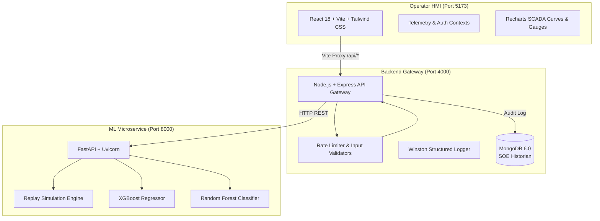

# ⚡ SmartDC-Energy

> **Hyperscale Data Center Energy Management & Operations Analytics Platform**  
> An enterprise-grade, supervisory SCADA/DCS operations platform integrating machine learning microservices for real-time electrical load forecasting, anomaly interception, and thermodynamic dispatch analysis.

[](https://react.dev/)
[](https://tailwindcss.com/)
[](https://nodejs.org/)
[](https://fastapi.tiangolo.com/)
[](https://www.mongodb.com/)
[-FF6600?style=flat-square)](https://xgboost.readthedocs.io/)
[-2BAF2B?style=flat-square)](https://scikit-learn.org/)
[](https://www.docker.com/)

---

## 📌 Overview & Problem Statement

Modern hyperscale data centers consume tens of megawatts (MW) of continuous power. High-density compute clusters (AI GPUs, blade servers) and cooling infrastructures (CRAC chillers, water loops) interact in a complex thermodynamic and electrical balance. Sudden demand surges, chiller failures, or ambient heatwaves can degrade Power Usage Effectiveness (PUE) and risk substation trip lockouts.

**SmartDC-Energy** models the 34.5 kV utility substation profile of a 15 MW facility (**Iowa Hyperscale DC-01**, baseline anchor **9,707.7 kW**), delivering sub-second supervisory intelligence to optimize energy dispatch, prevent electrical trips, and ensure ASHRAE compliance.

---

## 🎯 Project Objectives

- **Predictive Energy Forecasting**: Forecast total facility electricity demand (kWh) using an autoregressive XGBoost regressor trained on 25 operational and cyclical features ($R^2 = 0.8945$, $\text{MAE} = 130.9\text{ kW}$).
- **Substation Anomaly Interception**: Classify multi-sensor telemetry vectors in real time using a Random Forest classifier ($F_1 = 0.9943$, $\text{Accuracy} = 99.94\%$) to catch thermal surges and voltage sags.
- **Thermodynamic Monitoring**: Continuously track PUE, ASHRAE TC 9.9 server inlet temperatures, chilled water supply, humidity, and under-floor static pressure.
- **What-If Scenario Dispatch**: Provide an interactive simulation sandbox for operators to evaluate hypothetical compute loads, weather extremes, and cooling setpoints before committing dispatch orders.
- **Audit Historian Archive**: Asynchronously record telemetry streams and what-if queries into MongoDB for Sequence of Events (SOE) incident reviews.

---

## 🏛️ System Architecture

SmartDC-Energy is built as a decoupled 3-tier microservice system:



---

## 🛠️ Technology Stack

| Layer | Technologies | Role |
| :--- | :--- | :--- |
| **Frontend** | React 18, Vite, Tailwind CSS, Recharts | Dark-industrial SCADA HMI, real-time SVG arc meters, trend visualizers. |
| **Backend Gateway** | Node.js 20, Express 4, Winston, Helmet | Layered gateway with controllers, input validation, rate limiting, and MongoDB logging. |
| **ML Microservice** | Python 3.10, FastAPI, Uvicorn, Pydantic | In-memory inference engine serving dual predictions and test replay stream. |
| **ML Pipeline** | Scikit-learn, XGBoost, LightGBM, Pandas | 8 Jupyter notebooks for data cleaning, feature engineering, and model training. |
| **Database** | MongoDB 6.0, Mongoose | Non-blocking telemetry and what-if query audit trail. |
| **DevOps** | Docker, Docker Compose, Nginx | Multi-container orchestration with automatic startup model generation. |

---

## 🚀 Key Features

1. **Real-Time SCADA Operations**: Continuous 3-second telemetry stream displaying electricity consumed, ML demand forecast, IT vs. cooling allocation, and live PUE.
2. **Interactive Equipment Domains**: Dynamic inspection of primary consumers: IT Equipment (~78%), Cooling Systems (~18.5%), and Power Distribution (~3.5%).
3. **Multi-Mode Telemetry Curves**: High-resolution area and bar charts tracking demand vs. forecast, residual error margins, and Random Forest trip risk probabilities.
4. **BMS Environmental Monitor**: ISA-18.2 severity-calibrated gauges and sensor panels tracking ambient air, server inlet temperature (ASHRAE A1), chilled water, and static plenum pressure.
5. **What-If Plant Dispatch Lab**: Interactive scenario simulator with pre-configured presets (*Nominal Baseline*, *Peak Summer Heatwave*, *AI Training Surge*, *Cool Night Off-Peak*).
6. **Sequence of Events (SOE) Historian**: Chronological event log categorizing thermal surges, pump pressure drops, and feeder fluctuations with filtering.
7. **Operator Security Gate**: Role-based access portal (`WS-DISPATCH-01`) with 1-click evaluation entry and session isolation.

---

## 🧠 Machine Learning Benchmarks

The models were trained on 26,000+ hourly facility observations (`ai_datacenter_energy_2022_2025.csv`):

### 1. Electricity Demand Forecasting (`total_power_kwh`)
| Model Architecture | MAE (kW) | RMSE (kW) | $R^2$ Score | MAPE (%) | Status |
| :--- | :--- | :--- | :--- | :--- | :--- |
| **XGBoost (Champion)** | **130.91** | **164.20** | **0.8945** | **1.37%** | **In Production** |
| LightGBM | 132.22 | 164.95 | 0.8935 | 1.39% | Baseline |
| LSTM Neural Network | 167.48 | 209.26 | 0.8286 | 1.75% | Baseline |

### 2. Operational Anomaly Classification (`NOMINAL` vs `FAILURE`)
| Model Architecture | Precision | Recall | $F_1$-Score | Accuracy | ROC-AUC | Status |
| :--- | :--- | :--- | :--- | :--- | :--- | :--- |
| **Random Forest (Champion)** | **0.9962** | **0.9924** | **0.9943** | **99.94%** | **0.999996** | **In Production** |
| Isolation Forest | 0.1559 | 0.1742 | 0.1646 | 82.00% | 0.7207 | Baseline |

> **Feature Leakage Prevention**: Forecasting strictly excludes concurrent load breakdown (`it_load_kwh`, `cooling_load_kwh`, `pue`) to prevent target leakage, while anomaly detection includes them to classify physical plant state.

---

## 📂 Repository Structure

```
SmartDC-Energy/
├── client/                               # React 18 + Vite Frontend
│   ├── src/
│   │   ├── api/apiClient.js              # Axios instance (/api baseURL)
│   │   ├── components/                   # SCADA UI components (Gauges, Charts, Panels)
│   │   ├── context/                      # AuthContext & TelemetryContext (3s poll loop)
│   │   ├── pages/                        # LivePage, AnalyticsPage, WhatIfPage, LoginPage, AboutPage
│   │   ├── App.jsx                       # Authenticated layout & routes
│   │   └── main.jsx
│   ├── Dockerfile                        # Multi-stage build (Node build -> Nginx serve)
│   ├── nginx.conf                        # SPA routing & API reverse proxy
│   └── .env.example
│
├── server/                               # Layered Express Gateway
│   ├── src/
│   │   ├── config/                       # db.js (MongoDB) & logger.js (Winston)
│   │   ├── controllers/                  # live, analysis, and analytics controllers
│   │   ├── middleware/                   # Centralized error handler & rate limiters
│   │   ├── validators/                   # analysis.validator.js (numeric type guards)
│   │   ├── models/                       # SimulationLog & AnalysisQuery Mongoose schemas
│   │   ├── routes/                       # liveRoutes, analysisRoutes, analyticsRoutes
│   │   ├── services/mlServiceClient.js   # HTTP proxy to FastAPI microservice
│   │   ├── app.js                        # Express factory
│   │   └── server.js                     # HTTP listener & DB connection entry point
│   ├── tests/                            # node --test unit & integration test suite
│   ├── Dockerfile
│   └── .env.example
│
├── ml-service/                           # FastAPI ML Inference Microservice
│   ├── routers/                          # forecast, anomaly, combined, simulation, analytics
│   ├── inference_service.py              # Prediction handler & ASHRAE limit evaluator
│   ├── model_loader.py                   # In-memory singleton artifact loader
│   ├── simulation_engine.py              # Chronological test split replay engine
│   ├── schemas.py                        # Pydantic request/response schemas
│   ├── main.py                           # App entry point with startup sanity check
│   ├── entrypoint.sh                     # Auto-generates models on first boot if missing
│   ├── Dockerfile
│   └── requirements.txt
│
├── ml-pipeline/                          # Training Lab & Research Pipeline
│   ├── data/raw/                         # ai_datacenter_energy_2022_2025.csv (2.26 MB)
│   ├── data/processed/                   # Cleaned & master engineered features CSVs
│   ├── models/                           # Serialized models (.gitignore protected)
│   ├── results/                          # forecast_results.json & anomaly_results.json
│   ├── notebooks/                        # 01_data_cleaning to 08_integration.ipynb
│   └── requirements.txt
│
├── setup_models.py                       # 1-command local model generator (~3 seconds)
├── docker-compose.yml                    # Full-stack container orchestration
├── .gitignore                            # Excludes models, .env, and node_modules
└── README.md
```

---

## ⚡ Getting Started

### Prerequisites
- **Node.js 20+** and **npm**
- **Python 3.10+** and **pip**
- **MongoDB 6.x** (or MongoDB Atlas connection string)
- *(Optional)* **Docker & Docker Compose**

---

### Method 1: One-Click Docker Setup (Recommended)

Docker Compose automatically builds all containers, sets up MongoDB, generates missing ML model binaries, and links the microservices:

```bash
# 1. Clone the repository
git clone https://github.com/your-username/SmartDC-Energy.git
cd SmartDC-Energy

# 2. Launch the complete cluster
docker-compose up -d --build
```

**Running Services & Endpoints:**
- 🗄️ **MongoDB 6.0**: `localhost:27017` (Database & SOE Historian)
- 🧠 **FastAPI ML Microservice**: [http://localhost:8000/docs](http://localhost:8000/docs) (Swagger UI & Inference Engine)
- ⚙️ **Express Gateway API**: [http://localhost:4000](http://localhost:4000) (Security, Rate Limiting & Proxy)
- 🌐 **Operator HMI (Client)**: [http://localhost:5173](http://localhost:5173) (SCADA Dashboard)

To view logs or stop the cluster:
```bash
docker-compose logs -f
docker-compose down
```

---

### Method 2: Manual Local Setup (Without Docker)

> [!IMPORTANT]
> **Strict Startup Sequence & Dependency Chain**:  
> **MongoDB (Port 27017) ➔ ML Microservice (Port 8000) ➔ Backend Gateway (Port 4000) ➔ React Client (Port 5173)**  
> The Express server operates as an API Gateway that proxies requests to the ML microservice via HTTP (`axios`). Starting the Express backend before the ML microservice is online causes connection refusals (`ECONNREFUSED`) resulting in `502 ML service unavailable` errors when operators load the dashboard. Follow Steps 1 to 6 in exact sequential order across dedicated terminal windows.

#### Step 1: Initialize Environment Templates
```bash
# Copy template configurations
cp server/.env.example server/.env
cp client/.env.example client/.env
```

#### Step 2: Generate ML Model Binaries (~3 seconds)
Because large binary files are excluded from Git to keep the repository lightweight, generate them from the included dataset:
```bash
python setup_models.py
```

#### Step 3: Ensure MongoDB is Running (Port 27017)
Ensure your local MongoDB daemon is running for the Sequence of Events (SOE) historian:
```bash
# Verify connection (or start service with 'mongod')
mongosh --eval "db.runCommand({ ping: 1 })"
```

#### Step 4: Start the ML Microservice (Port 8000) — Terminal 1
> **Must be started before the backend gateway** so prediction engines, scalers, and simulation replay buffers are initialized in memory.

```bash
cd ml-service
python -m venv venv

# Activate venv:
# Windows (PowerShell): venv\Scripts\Activate.ps1 | macOS/Linux: source venv/bin/activate
pip install -r requirements.txt
uvicorn main:app --reload --port 8000
```
Verify the microservice is operational by visiting [http://localhost:8000/docs](http://localhost:8000/docs).

#### Step 5: Start the Backend Gateway (Port 4000) — Terminal 2
Open a second terminal window:
```bash
cd server
npm install
npm test          # Runs automated test suite (6/6 passing)
npm run dev       # Starts server on http://localhost:4000
```

#### Step 6: Start the React Client (Port 5173) — Terminal 3
Open a third terminal window:
```bash
cd client
npm install
npm run dev
```
Open [http://localhost:5173](http://localhost:5173) in your browser.

---

## 🔑 Default Operator Credentials

The application enforces operator login to emulate industrial DCS workstation security:

| Parameter | Value |
| :--- | :--- |
| **Operator Tag** | `operator@smartdc.internal` |
| **Passkey** | `scada-secure-2026` |
| **Facility Substation** | `IOWA-HYPERSCALE-01` |
| **Operator ID** | `OP-8492 (Lead Dispatcher)` |
| **MFA Code** | `749210` |

> ⚡ **Quick Login**: You can click the **"1-Click Quick Entry (Iowa-01 Lead Dispatcher)"** button on the login screen to bypass manual typing and immediately enter the control console.

---

## 🧪 Testing & Verification

The project includes automated tests across the stack:

```bash
# Run backend unit & integration tests:
cd server
npm test

# Verify frontend production build:
cd client
npm run build
```

---

## 📜 License & Acknowledgments

- **License**: Released under the [MIT License](LICENSE).
- **Academic Context**: B.Tech Final Year Capstone Project in Computer Science & Engineering.
- **Standards Aligned**: Modeled after **ASHRAE TC 9.9** Thermal Guidelines, **ISA-18.2** Alarm Management standards, and Distributed Control System (DCS) interface conventions.
