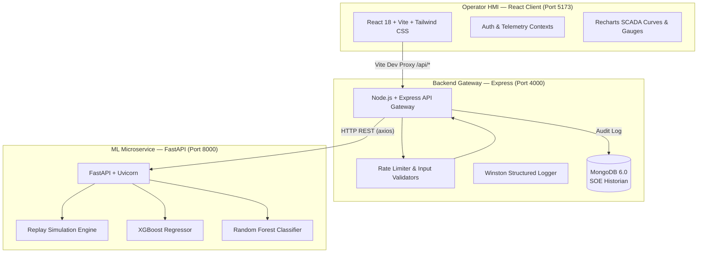

# ⚡ SmartDC-Energy

> **Hyperscale Data Center Energy Management & Operations Analytics Platform**
>
> A full-stack supervisory platform integrating machine learning microservices for electrical load forecasting, anomaly interception, and thermodynamic dispatch analysis — modeled after industrial SCADA/DCS control interfaces.

[](https://react.dev/)
[](https://tailwindcss.com/)
[](https://nodejs.org/)
[](https://fastapi.tiangolo.com/)
[](https://www.mongodb.com/)
[-FF6600?style=flat-square)](https://xgboost.readthedocs.io/)
[-2BAF2B?style=flat-square)](https://scikit-learn.org/)
[](https://www.docker.com/)

<!-- TODO: Add screenshot of Live Operations dashboard here -->
<!--  -->

---

## 📑 Table of Contents

- [Overview & Problem Statement](#-overview--problem-statement)
- [Project Objectives](#-project-objectives)
- [System Architecture](#-system-architecture)
- [Technology Stack](#-technology-stack)
- [Key Features & UI Pages](#-key-features--ui-pages)
- [Dataset & Data Pipeline](#-dataset--data-pipeline)
- [Machine Learning Benchmarks](#-machine-learning-benchmarks)
- [Repository Structure](#-repository-structure)
- [Getting Started](#-getting-started)
- [Demo Operator Login](#-demo-operator-login)
- [Testing & Verification](#-testing--verification)
- [Technical Documentation & Guides](#-technical-documentation--guides)
- [License & Acknowledgments](#-license--acknowledgments)
<!-- - [Team & Credits](#-team--credits) -->

---

## 📌 Overview & Problem Statement

Modern hyperscale data centers consume tens of megawatts (MW) of continuous power. High-density compute clusters (AI GPUs, blade servers) and cooling infrastructures (CRAC chillers, water loops) interact in a complex thermodynamic and electrical balance. Sudden demand surges, chiller failures, or ambient heatwaves can degrade Power Usage Effectiveness (PUE) and risk substation trip lockouts.

**SmartDC-Energy** models the 34.5 kV utility substation profile of a 15 MW facility (**Iowa Hyperscale DC-01**, baseline anchor **9,707.7 kWh**), delivering sub-second supervisory intelligence to optimize energy dispatch, prevent electrical trips, and ensure ASHRAE compliance.

> [!NOTE]
> This platform operates on a **synthetic dataset** (see [Dataset & Data Pipeline](#-dataset--data-pipeline)) and replays pre-computed test data to simulate a live telemetry stream. It is designed as an academic capstone demonstrating end-to-end ML-integrated system design — not a production facility controller.

---

## 🎯 Project Objectives

- **Predictive Energy Forecasting**: Forecast total facility electricity demand using an autoregressive XGBoost regressor trained on 25 operational and cyclical features ($R^2 = 0.8945$, MAE = 130.9 kWh).
- **Substation Anomaly Interception**: Classify multi-sensor telemetry vectors using a Random Forest classifier ($F_1 = 0.9943$, Accuracy = 99.94%) to catch thermal surges and voltage sags before they escalate.
- **Thermodynamic Monitoring**: Continuously track PUE, ASHRAE TC 9.9 server inlet temperatures, chilled water supply, humidity, and under-floor static pressure.
- **What-If Scenario Dispatch**: Provide an interactive simulation sandbox for operators to evaluate hypothetical compute loads, weather extremes, and cooling setpoints before committing dispatch orders.
- **Audit Historian Archive**: Asynchronously record telemetry streams and what-if queries into MongoDB for Sequence of Events (SOE) incident reviews.

---

## 🏛️ System Architecture

SmartDC-Energy is built as a decoupled 3-tier microservice system:



**Data Flow**: The React client sends all `/api/*` requests through the Vite dev proxy (or Nginx in production) to the Express gateway on port 4000. Express validates inputs, applies rate limiting, then forwards ML-related requests via HTTP to the FastAPI microservice on port 8000. Responses flow back through the same chain, and audit records are written to MongoDB asynchronously.

---

## 🛠️ Technology Stack

| Layer | Technologies | Role |
| :--- | :--- | :--- |
| **Frontend** | React 18, Vite 5, Tailwind CSS, Recharts | Dark-industrial SCADA HMI with real-time SVG arc meters, trend visualizers, and ISA-18.2 gauges. |
| **Backend Gateway** | Node.js 20, Express 4, Winston, Helmet | Layered API gateway with controllers, input validation, rate limiting (100 req/15 min), and MongoDB audit logging. |
| **ML Microservice** | Python 3.10+, FastAPI, Uvicorn, Pydantic v2 | In-memory inference engine serving dual predictions (forecast + anomaly) and a chronological test replay stream. |
| **ML Pipeline** | Scikit-learn, XGBoost, LightGBM, Pandas, NumPy | 8 Jupyter notebooks (`01_data_cleaning` → `08_integration`) for data cleaning, feature engineering, and model training. |
| **Database** | MongoDB 6.0, Mongoose 8 | Non-blocking audit trail for simulation telemetry logs and what-if analysis query history. |
| **DevOps** | Docker, Docker Compose, Nginx | Multi-container orchestration with healthchecks and automatic model generation on first boot via `entrypoint.sh`. |

---

## 🚀 Key Features & UI Pages

### Features

1. **Real-Time SCADA Operations**: Continuous 3-second telemetry polling displaying electricity consumed, ML demand forecast, IT vs. cooling allocation, and live PUE.
2. **Interactive Equipment Domains**: Dynamic inspection of primary consumers — IT Equipment (~78%), Cooling Systems (~18.5%), and Power Distribution (~3.5%).
3. **Multi-Mode Telemetry Curves**: High-resolution area and bar charts tracking demand vs. forecast, residual error margins, and anomaly trip risk probabilities.
4. **BMS Environmental Monitor**: ISA-18.2 severity-calibrated gauges tracking ambient air, server inlet temperature (ASHRAE A1), chilled water, and static plenum pressure.
5. **What-If Plant Dispatch Lab**: Interactive scenario simulator with pre-configured presets (*Nominal Baseline*, *Peak Summer Heatwave*, *AI Training Surge*, *Cool Night Off-Peak*).
6. **Sequence of Events (SOE) Historian**: Chronological event log (embedded in the Live Operations page) categorizing thermal surges, pump pressure drops, and feeder fluctuations with filtering.

### UI Pages

| Page | Route | Description |
| :--- | :--- | :--- |
| **Login Gate** | `/` | Simulated DCS workstation login with 1-click quick entry for evaluation. |
| **Live Operations** | `/dashboard` | Real-time SCADA console with telemetry stream, equipment domains, trend curves, environmental gauges, and embedded SOE historian panel. |
| **What-If Dispatch** | `/whatif` | Interactive scenario simulator for hypothetical load/weather dispatch analysis. |
| **Analytics** | `/analytics` | Model performance benchmarks, forecast vs. actual comparisons, and anomaly detection metrics. |
| **About** | `/about` | Project overview, technology stack, and architecture walkthrough. |

---

## 📊 Dataset & Data Pipeline

> [!IMPORTANT]
> The dataset used in this project is **synthetic** — it was generated to model the operational profile of a 15 MW hyperscale data center. It is not sourced from a real facility. The anomaly labels (`normal` / `failure`) are rule-based injections at a controlled ~5% class ratio, which contributes to the high anomaly detection metrics.

| Property | Value |
| :--- | :--- |
| **Raw File** | `ml-pipeline/data/raw/ai_datacenter_energy_2022_2025.csv` |
| **Records** | 26,308 hourly observations |
| **Time Range** | 2022-01-01 to 2024-12-30 (3 years of hourly data) |
| **Raw Columns** | 11 (timestamp + 5 environmental sensors + 4 power meters + PUE) |
| **Processed File** | `ml-pipeline/data/processed/master_features.csv` |
| **Engineered Features** | 22 columns (original 11 + 11 engineered: cyclical encodings, lag features, rolling statistics, binary flags) |
| **Processed Records** | 26,280 (28 rows dropped during cleaning) |
| **Target Variable** | `total_power_kwh` — total hourly facility energy consumption |
| **Anomaly Class Balance** | 94.97% normal / 5.03% failure |

> [!NOTE]
> **Unit Convention**: The target `total_power_kwh` represents energy consumed per hourly interval. Since each observation spans exactly one hour, the numeric value in kWh is equivalent to the average power draw in kW for that hour.

**Pipeline Notebooks** (in `ml-pipeline/notebooks/`):

| # | Notebook | Purpose |
| :--- | :--- | :--- |
| 01 | `01_data_cleaning.ipynb` | Missing value imputation, timestamp parsing, outlier treatment |
| 02 | `02_feature_engineering.ipynb` | Cyclical encodings, lag features (1h–168h), rolling statistics |
| 03 | `03_eda.ipynb` | Exploratory data analysis, correlation matrices, distribution plots |
| 04 | `04_forecasting_models.ipynb` | XGBoost, LightGBM, LSTM model training for demand forecasting |
| 05 | `05_forecasting_evaluation.ipynb` | MAE/RMSE/MAPE/R² evaluation, cross-validation, extreme weather testing |
| 06 | `06_anomaly_models.ipynb` | Random Forest, Isolation Forest training for anomaly classification |
| 07 | `07_anomaly_evaluation.ipynb` | Precision/Recall/F1, ROC-AUC, confusion matrix analysis |
| 08 | `08_integration.ipynb` | End-to-end pipeline validation, test data intersection, export |

---

## 🧠 Machine Learning Benchmarks

### Training Methodology

- **Forecasting (Regression)**: 80/20 **chronological** train/test split (first 80% of timestamped data for training, last 20% for testing) — preserves temporal causality and prevents future data leakage.
- **Anomaly Detection (Classification)**: 80/20 **stratified-random** split (`stratify=y`) — maintains the 95:5 class ratio in both train and test sets.
- **Feature Leakage Prevention**: Forecasting strictly excludes concurrent load breakdown columns (`it_load_kwh`, `cooling_load_kwh`, `support_load_kwh`, `pue`) to prevent target leakage. Anomaly detection deliberately includes them because classifying physical plant state requires knowing the current load distribution.

### 1. Electricity Demand Forecasting (`total_power_kwh`)

| Model | MAE (kWh) | RMSE (kWh) | $R^2$ | MAPE (%) | Status |
| :--- | :--- | :--- | :--- | :--- | :--- |
| **XGBoost** | **130.91** | **164.20** | **0.8945** | **1.37** | ✅ Deployed |
| LightGBM | 132.22 | 164.95 | 0.8935 | 1.39 | Baseline comparison |
| LSTM Neural Network | 167.48 | 209.26 | 0.8286 | 1.75 | Baseline comparison |

**Top 5 Feature Importances (XGBoost)**: `lag_1h` (59.4%), `lag_168h` (17.4%), `lag_24h` (4.6%), `hour_cos` (4.1%), `hour_sin` (3.0%)

### 2. Operational Anomaly Classification (`normal` vs `failure`)

| Model | Precision | Recall | $F_1$ | Accuracy | ROC-AUC | Status |
| :--- | :--- | :--- | :--- | :--- | :--- | :--- |
| **Random Forest** | **0.9962** | **0.9924** | **0.9943** | **99.94%** | **0.9999** | ✅ Deployed |
| Isolation Forest | 0.1559 | 0.1742 | 0.1646 | 82.00% | 0.7207 | Baseline comparison |

**Confusion Matrix (Random Forest)**: TP = 262, FP = 1, FN = 2, TN = 4,991

> [!NOTE]
> The near-perfect Random Forest metrics (F₁ = 0.994) reflect the synthetic nature of the dataset — failure labels are rule-based injections that produce clean decision boundaries. Real-world anomaly detection on noisy sensor data would yield lower metrics. The naïve baseline accuracy (always predicting "normal") is 94.97%, confirming that the model adds genuine discriminative value beyond the class imbalance.

---

## 📂 Repository Structure

```
SmartDC-Energy/
├── client/                               # React 18 + Vite Frontend
│   ├── src/
│   │   ├── api/apiClient.js              # Axios instance (/api baseURL)
│   │   ├── components/                   # SCADA UI components (Gauges, Charts, Panels)
│   │   ├── context/                      # AuthContext & TelemetryContext (3s poll loop)
│   │   ├── pages/                        # LivePage, AnalyticsPage, WhatIfPage, LoginPage, AboutPage
│   │   ├── App.jsx                       # Authenticated layout & routes
│   │   └── main.jsx
│   ├── vite.config.js                    # Dev proxy (/api → localhost:4000)
│   ├── Dockerfile                        # Multi-stage build (Node build → Nginx serve)
│   ├── nginx.conf                        # SPA routing & API reverse proxy
│   └── .env.example
│
├── server/                               # Layered Express Gateway
│   ├── src/
│   │   ├── config/                       # db.js (MongoDB) & logger.js (Winston)
│   │   ├── controllers/                  # live, analysis, and analytics controllers
│   │   ├── middleware/                   # Centralized error handler & rate limiters
│   │   ├── validators/                   # analysis.validator.js (numeric type guards)
│   │   ├── models/                       # SimulationLog & AnalysisQuery Mongoose schemas
│   │   ├── routes/                       # liveRoutes, analysisRoutes, analyticsRoutes
│   │   ├── services/mlServiceClient.js   # HTTP proxy to FastAPI microservice
│   │   ├── app.js                        # Express app factory (testable without port binding)
│   │   └── server.js                     # HTTP listener & DB connection entry point
│   ├── tests/                            # node --test unit & integration test suite
│   ├── Dockerfile
│   └── .env.example
│
├── ml-service/                           # FastAPI ML Inference Microservice
│   ├── routers/                          # forecast, anomaly, combined, simulation, analytics
│   ├── inference_service.py              # Prediction handler & ASHRAE limit evaluator
│   ├── model_loader.py                   # In-memory singleton artifact loader (7 .pkl files)
│   ├── simulation_engine.py              # Chronological test split replay engine
│   ├── schemas.py                        # Pydantic request/response schemas
│   ├── main.py                           # App entry point with startup sanity check
│   ├── entrypoint.sh                     # Auto-generates models on first Docker boot if missing
│   ├── Dockerfile
│   └── requirements.txt
│
├── ml-pipeline/                          # Training Lab & Research Pipeline
│   ├── data/raw/                         # ai_datacenter_energy_2022_2025.csv (2.26 MB)
│   ├── data/processed/                   # master_features.csv (cleaned + engineered)
│   ├── models/                           # Serialized .pkl binaries (.gitignore protected)
│   ├── results/                          # forecast_results.json & anomaly_results.json
│   ├── notebooks/                        # 01_data_cleaning → 08_integration (8 notebooks)
│   └── requirements.txt
│
├── docs/                                 # Technical documentation & guides
│   ├── API.md                            # Comprehensive REST API reference & schemas
│   ├── CONFIGURATION.md                  # Environment variables & rate limiting reference
│   └── TROUBLESHOOTING.md               # Quick diagnosis matrix & runtime solutions
│
├── setup_models.py                       # 1-command local model generator (~3 seconds)
├── docker-compose.yml                    # Full-stack container orchestration
├── .gitignore                            # Excludes .pkl models, .env, node_modules, venv
├── LICENSE                               # MIT License
└── README.md
```

---

## ⚡ Getting Started

### Prerequisites

- **Node.js 20+** and **npm**
- **Python 3.10+** and **pip**
- **MongoDB 6.x** running locally (or a MongoDB Atlas connection string)
- *(Optional)* **Docker** and **Docker Compose** for one-command setup

---

### Method 1: Docker Setup (Recommended)

Docker Compose automatically builds all containers, spins up MongoDB, generates missing ML model binaries via `entrypoint.sh`, and links the microservices with healthcheck-based dependency ordering:

```bash
# 1. Clone the repository
git clone https://github.com/dhruvajyoti1/SMART_DC.git
cd SMART_DC

# 2. Launch the complete cluster
docker compose up -d --build
```

**Running Services:**

| Service | URL | Description |
| :--- | :--- | :--- |
| 🗄️ MongoDB | `localhost:27017` | Database & SOE Historian |
| 🧠 ML Microservice | [http://localhost:8000/docs](http://localhost:8000/docs) | Swagger UI & Inference Engine |
| ⚙️ Express Gateway | [http://localhost:4000](http://localhost:4000) | API Gateway, Rate Limiting & Proxy |
| 🌐 Operator HMI | [http://localhost:5173](http://localhost:5173) | SCADA Dashboard |

```bash
# View logs or stop the cluster
docker compose logs -f
docker compose down
```

---

### Method 2: Manual Local Setup

> [!IMPORTANT]
> **Strict Startup Sequence — Follow Steps 1–6 in Order**
>
> ```
> MongoDB (:27017) → ML Microservice (:8000) → Backend Gateway (:4000) → React Client (:5173)
> ```
>
> The Express backend proxies all ML requests to the FastAPI microservice via HTTP. If Express starts before FastAPI is online, it returns `502 ML service unavailable` errors (`ECONNREFUSED`). Always start the ML microservice first.

#### Step 1: Clone & Initialize Environment

```bash
git clone https://github.com/dhruvajyoti1/SMART_DC.git
cd SMART_DC

# Copy environment templates (edit values as needed)
cp server/.env.example server/.env
cp client/.env.example client/.env
```

#### Step 2: Generate ML Model Binaries (~3 seconds)

Large binary model files (`.pkl`) are excluded from Git to prevent GitHub's 100 MB push rejection. Generate them locally from the included dataset:

```bash
python setup_models.py
```

#### Step 3: Ensure MongoDB is Running (Port 27017)

```bash
# Verify connection (or start the service with 'mongod')
mongosh --eval "db.runCommand({ ping: 1 })"
```

#### Step 4: Start the ML Microservice (Port 8000) — Terminal 1

> **Must be started before the backend gateway.**

```bash
cd ml-service
python -m venv venv

# Activate virtual environment:
# Windows PowerShell: venv\Scripts\Activate.ps1
# macOS / Linux:      source venv/bin/activate

pip install -r requirements.txt
uvicorn main:app --reload --port 8000
```

Verify at [http://localhost:8000/docs](http://localhost:8000/docs) — you should see the Swagger UI.

#### Step 5: Start the Backend Gateway (Port 4000) — Terminal 2

```bash
cd server
npm install
npm test        # Runs automated test suite
npm run dev     # Starts Express on http://localhost:4000
```

#### Step 6: Start the React Client (Port 5173) — Terminal 3

```bash
cd client
npm install
npm run dev
```

Open [http://localhost:5173](http://localhost:5173) in your browser.

---

## 🔑 Demo Operator Login

The application includes a simulated DCS workstation login gate to emulate industrial access control. **This is a client-side demo gate** — credentials are hardcoded in the frontend for evaluation convenience. No server-side authentication or JWT is implemented in this version.

| Parameter | Value |
| :--- | :--- |
| **Operator Tag** | `operator@smartdc.internal` |
| **Passkey** | `scada-secure-2026` |
| **Facility Substation** | `IOWA-HYPERSCALE-01` |
| **Operator ID** | `OP-8492 (Lead Dispatcher)` |
| **MFA Code** | `749210` |

> ⚡ **Quick Login**: Click the **"1-Click Quick Entry (Iowa-01 Lead Dispatcher)"** button on the login screen to bypass manual entry and immediately access the control console.

---

## 🧪 Testing & Verification

```bash
# Backend unit & integration tests (Node.js built-in test runner):
cd server
npm test

# Frontend production build verification (905 modules):
cd client
npm run build

# ML microservice health check:
curl http://localhost:8000/
# Expected: {"status":"ok","service":"SmartDC-Energy ML Service"}
```

---

## 📚 Technical Documentation & Guides

Comprehensive technical details and runtime guides have been organized into the [`docs/`](docs/) directory:

| Document | Contents |
| :--- | :--- |
| 📡 [**API Reference**](docs/API.md) | Complete endpoint schemas for Express Gateway (:4000) and FastAPI (:8000), cURL / PowerShell request examples, and HTTP error codes. |
| ⚙️ [**Configuration Reference**](docs/CONFIGURATION.md) | Detailed environment variable tables for `server/.env`, `client/.env`, Docker network overrides, and API rate limiting rules. |
| 🔧 [**Troubleshooting Guide**](docs/TROUBLESHOOTING.md) | Solutions for common runtime issues: startup order 502 errors, port conflicts, MongoDB connection issues, and PowerShell execution policy. |

> 🧠 **Interactive Swagger UI**: When the ML service is running, explore all prediction and simulation endpoints interactively at [http://localhost:8000/docs](http://localhost:8000/docs).

---

## 📜 License & Acknowledgments

- **License**: Released under the [MIT License](LICENSE).
- **Academic Context**: B.Tech Final Year Capstone Project in Computer Science & Engineering.
- **Standards Referenced**: Modeled after [ASHRAE TC 9.9](https://tc0909.ashraetcs.org/) Thermal Guidelines, [ISA-18.2](https://www.isa.org/standards-and-publications/isa-standards/isa-standards-committees/isa18) Alarm Management standards, and Distributed Control System (DCS) interface conventions.

<!--
## 👥 Team & Credits

| Name | Role | GitHub |
| :--- | :--- | :--- |
| TODO: Your Name | Project Lead & Full-Stack Developer | [@dhruvajyoti1](https://github.com/dhruvajyoti1) |
| TODO: Team Member | ML Pipeline & Model Training | [@github_handle](https://github.com/) |
| TODO: Team Member | Frontend Development | [@github_handle](https://github.com/) |
| **Supervisor**: TODO: Supervisor Name | Faculty Advisor | Department of CSE, Institution Name |
-->
